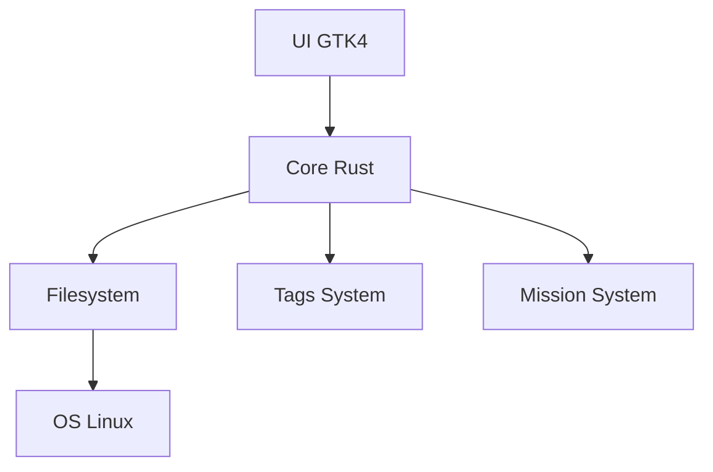

###### README.md >> markdown
###### Version ultime, moderne, stylée, professionnelle, avec badges dynamiques, sections détaillées, diagrammes, installation rapide, packaging, architecture, roadmap, et un logo SVG personnalisé tmdgFiles.

# 🟩 tmdgFiles
> **Corporate Edition**

<p align="center">

</p>

### Gestionnaire de fichiers
- ***Rust + GTK4***
- **Version : v1.0.x — Linux Native**


---

### 🧭 Présentation

**tmdgFiles** est un gestionnaire de fichiers **moderne**, **rapide** et **modulaire**, développé en **Rust** avec une interface graphique **GTK4**.  
Il vise à offrir une expérience fluide, stable et extensible pour les environnements **Linux Desktop**.
```text
- Fonctionnalités clés :
   - Interface GTK4 moderne  
   - Architecture Rust modulaire  
   - Système de **tags** interne  
   - Système de **missions** (batch operations)  
   - Navigation rapide et optimisée  
   - Compatible **toutes distributions Linux**  
   - Documentation complète + scripts d’installation
```

---

### 🏗️ Architecture du projet
Documentation complète :
```text
- `tmdgFiles/docs/` 
```

### 📐 Diagramme (Mermaid)


### 📁 Arborescence
```text
- `tmdgFiles/docs/structure.md`

```

---

### 🐧 Compatibilité Linux
> tmdgFiles fonctionne sur toutes les distributions Linux modernes :
```text
- Debian / Ubuntu / Pop!_OS / Mint  
- Fedora / RHEL / Rocky / AlmaLinux  
- Arch Linux / Manjaro / EndeavourOS  
- openSUSE Leap / Tumbleweed  
- NixOS  
- Gentoo  
```

> Dépendances :
```text
- Rust ≥ 1.70  
- Cargo  
- GTK4 + dev packages  
- pkg-config  
- Git  
```

---

### 🚀 Installation rapide (toutes distributions Linux)

1. Rendre le script exécutable :
```bash
chmod +x install.sh
```

2. Lancer l’installation :
```bash
./install.sh
```

3. Ce script :
- *détecte automatiquement la distribution*
- *installe les dépendances  
- installe *Rust* si nécessaire  
- *compile tmdgFiles* 
- installe le binaire dans */usr/local/bin/tmdgfiles*

---

### 📦 Installation manuelle
- Voir : **docs/INSTALLATIONS/INSTALL.md**

---

### 🧰 Compilation avancée
- Voir : **docs/INSTALLATIONS/BUILD.md**

- Exemples :
   - Optimisation CPU native
```bash
RUSTFLAGS="-C target-cpu=native" cargo build --release
```

   - Compilation Debug
```bash
cargo build
./target/debug/tmdgFiles
```

---

### 📦 Packaging Linux
- Voir : **docs/INSTALLATIONS/PACKAGE.md**

- Formats supportés :
```md
- .deb  
- .rpm  
- AUR  
- AppImage  
```

---

### 🧹 Désinstallation
- Voir : **docs/INSTALLATIONS/UNINSTALL.md**

---

### 🛡️ Qualité & gouvernance
```text
- tmdgFiles/CODEOWNERS  
- .github/ISSUE_TEMPLATE/  
- .github/PULLREQUESTTEMPLATE.yml  
- .github/workflows/  
- tmdgFiles/CHANGELOG.md (v1.0.0 → v1.0.9)
```

---

### 📈 Roadmap v2.0.0
```md
- UI avancée (drag & drop, multi‑panneaux)  
- Système de missions v2.0  
- Système de tags v2.0  
- Mode headless (CLI)  
- Mode daemon (surveillance filesystem)  
- Packaging AppImage officiel  
- Intégration Flatpak  
```

---

### 🤝 Contribution
- Voir :
```text
- CONTRIBUTING.md  
- CODEOWNERS  
- .github/ISSUE_TEMPLATE/  
- .github/PULLREQUESTTEMPLATE.yml
```

---

📜 Licence

Projet sous licence **TheUnlicense**.

---

<div align="center">

tmdgFiles — Rust. GTK4. Linux. Performance.

</div>

---
